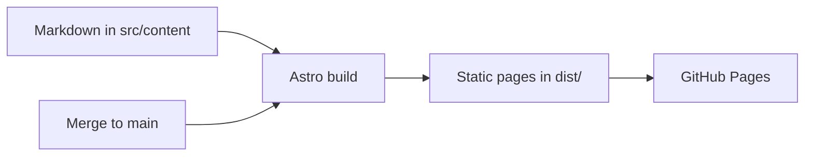

# sudhir13s.github.io

Sudhir Singh's personal site, live at **[sudhir13s.github.io](https://sudhir13s.github.io)**. Plain words about who I am, not a resume. Layout inspired by [rishimehta.xyz](https://rishimehta.xyz).



## Quick start

```bash
pnpm install
pnpm dev
# → http://localhost:4321
```

## Prerequisites

Node 24 (the version CI uses) and pnpm 11 (pinned in `package.json`).

## Development

| Command | What it does |
| --- | --- |
| `pnpm dev` | Runs the site locally |
| `pnpm run build` | Builds the site into `dist/` |
| `pnpm run preview` | Serves the built site locally |
| `pnpm run check` | Type-checks the code |
| `pnpm exec prettier --write .` | Formats the code |

This site has no test suite, on purpose. To check a change, build it and look at the page.

## Project layout

| Path | What's in it |
| --- | --- |
| `src/content/pages/` | About, Experience, Projects, Research, Education, and Blog intro text |
| `src/content/blog/` | Blog posts, none yet |
| `src/content/profile.json` | Name, headline, and links |
| `src/layouts/`, `src/pages/` | The page shell and routes |
| `src/styles/site.css` | All styling |
| `public/` | Photo and resume PDF, served as they are |

## Changing the content

- **A page:** edit its file in `src/content/pages/`. Its `order` sets its place in the top navigation.
- **Name, headline, links:** edit `src/content/profile.json`. The left rail shows GitHub, LinkedIn, and Email.
- **A blog post:** add a Markdown file to `src/content/blog/` with `title`, `date`, and `summary`.
- **Photo:** replace `public/avatar.jpg`, a 200×200 crop of the image in `profile/`.
- **Resume:** replace `public/Sudhir_Singh_Resume.pdf`, keeping the name. Experience links to it.
- **Links to files in `public/`:** make them relative, like `../Sudhir_Singh_Resume.pdf`.

## Deploying

- **Publishing:** `.github/workflows/deploy.yml` publishes to GitHub Pages on every merge to `main`, so unfinished edits shouldn't be merged. It can also be run by hand.
- **Checks:** `.github/workflows/ci.yml` type-checks and builds every pull request.
- **Pages setting:** the repo's Pages source is **GitHub Actions**.
- **Custom domain:** add it in the repo's **Settings → Pages**, point its DNS at GitHub, and set `SITE_URL` to it in the deploy workflow.

## Private files

PDFs in `profile/` are git-ignored working copies. The published resume is `public/Sudhir_Singh_Resume.pdf`, and it includes contact details on purpose.

## Old site

The previous site's code is kept in [sudhir-singh-old-github-io](https://github.com/sudhir13s/sudhir-singh-old-github-io). It's no longer published.
